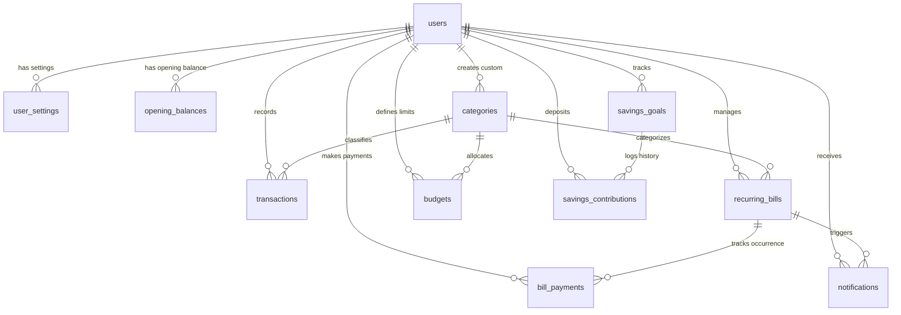

# SmartSpend — Smart Expense Tracker & Personal Money Management System

[](https://www.php.net/)
[](https://www.mysql.com/)
[](LICENSE)
[](#)

> **A financial application built to help users make smarter financial decisions, not just record numbers.**

---

## 🌟 Executive Overview

Most traditional expense trackers merely show users what they have already spent. **SmartSpend** is a personal financial management system designed to answer critical forward-looking questions:

1. **How much money did I earn and where is it going?**
2. **How much money should I realistically save based on my income?**
3. **What is my safe daily discretionary spending allowance?**
4. **Which bills must I pay this month and are any overdue?**
5. **Will I have enough money for upcoming obligations?**
6. **"Can I Afford This?"** — Can I buy a ₹15,000 gadget today without harming upcoming bills or draining my emergency fund?

SmartSpend combines salary-based financial capacity planning, recurring bill scheduling, atomic bill payment recording, goal milestone tracking, deterministic behavioral insights, and an interactive affordability calculator into a clean SaaS dashboard.

---

## 🛠 Technology Stack

- **Frontend**: HTML5, CSS3 (Modern Dark SaaS Theme with CSS Variables), Vanilla JavaScript (No heavyweight frameworks or node dependencies).
- **Backend**: Modular PHP 8.2+ Architecture (Clean Separation of Concerns: Config, Includes, Services, Actions, and Views).
- **Database**: MySQL / MariaDB via PHP Data Objects (**PDO**) with strict prepared statements, foreign keys, and ACID transactions.
- **Visualizations**: [Chart.js 4.4+](https://www.chartjs.org/) (Income vs. Expense, Category Doughnut, 6-Month Trajectory, Budget vs. Actual).
- **Icons & Typography**: [Lucide Icons](https://lucide.dev/) and Google Fonts [Inter](https://fonts.google.com/specimen/Inter).
- **Environment**: Compatible with Windows XAMPP, WampServer, Laragon, or standalone Apache/Nginx + PHP.

---

## 🎯 Key Application Modules & Features

### 1. 5-Step Financial Onboarding Wizard
- Collects income details, pay day of month, fixed vs. variable income nature.
- Records monthly living commitment estimates (rent, food, electricity, transport, loans).
- Selects savings style: **Conservative** (10%), **Balanced** (20%), or **Ambitious** (30%+).
- Automatically calculates and presents a preliminary financial plan before launching the dashboard.

### 2. Comprehensive Financial Dashboard
- **8 Core Financial Metrics Cards**: Total Income, Total Expenses, Account Cash Balance, Planned Savings Target, Actual Savings Contributions, Upcoming Bills Total, Remaining Flexible Budget, and Budget Usage Percentage.
- **5 Dynamic Chart.js Visualizations**: Real-time category doughnut, 6-month trends, income vs. expense comparison, and category budget variances.
- **Upcoming Bills Widget**: Visual urgency badges (*Due Today, Due Soon, Overdue*) with 1-click payment recording.
- **Deterministic Financial Insights**: Data-driven behavioral recommendations based on apples-to-apples period comparisons.

### 3. Smart Salary-Based Money Management Engine
- **Transparent Mathematical Capacity Formula**:
  $$\text{Projected Flexible Spending} = \text{Expected Income} - \text{Essential Costs} - \text{Unpaid Separate Bills} - \text{Planned Savings}$$
- **Zero Double-Counting**: Automatically prevents subtracting bills twice if their parent category is already budgeted.
- **Safe Daily Discretionary Allowance**: Dynamically computes how much the user can spend per day across remaining days in the budget period.
- **Category Budgets**: Configurable monthly spending limits with color-coded utilization progress bars.

### 4. Recurring Bills & Payment Management
- Supports **weekly, monthly, bi-monthly, quarterly, half-yearly, and yearly** frequencies.
- **Intelligent Month-End Date Preservation**: Correctly handles bills due on the 31st during shorter months (February 28/29, April 30) without losing the original intended due day.
- **Atomic Payment Processing**: Recording a bill payment runs within a database transaction, logs payment history, updates next recurrence, and creates exactly one linked expense transaction. Prevents duplicate payments for the same cycle.

### 5. Interactive Monthly Bill Calendar
- Full calendar view with due dates plotted on day cells.
- Highlights paid vs. unpaid bills and gives immediate access to payment actions.

### 6. "Can I Afford This?" Purchase Calculator
- Analyzes proposed purchases against:
  1. Current liquid cash reserve.
  2. Upcoming unpaid bills due in the current period.
  3. Remaining flexible spending allowance.
  4. Active monthly savings goals.
- Provides a clear evaluation verdict (*Comfortably Affordable*, *Budget Tight*, or *Not Recommended*).
- Delivers practical alternatives: 3-month savings plan, waiting until the next salary cycle, or cutting non-essential spending.

### 7. Smart Savings Goals Tracker
- Set financial milestones (e.g. Emergency Fund, Laptop, Travel).
- Automatically computes required monthly deposits: $\lceil(\text{Target} - \text{Saved}) / \text{Months Left}\rceil$.
- Supports deposit and withdrawal logging with complete audit trail.

### 8. Financial Insights & Subscription Auditor
- Compares equivalent elapsed periods (e.g., first 24 days of current month vs. first 24 days of last month) to detect category surges ($\ge 20\%$).
- Dedicated subscription auditor to identify recurring digital memberships and quantify their annual burden.

### 9. Filterable Ledger, Reports & CSV Export
- Search, filter by type, category, payment method, and custom date ranges.
- Safe CSV export with UTF-8 BOM encoding for seamless Excel compatibility.

### 10. Persistent Notification Center & Background Worker
- Automated reminders triggered 7 days, 3 days, 1 day, on the due date, and when overdue.
- Unique hash keys prevent duplicate reminder generation.
- Includes a standalone command-line background worker (`cron/process_bill_reminders.php`).

---

## 🔒 Security Architecture

- **Password Hashing**: Secure bcrypt using `password_hash()` and `password_verify()`.
- **Prepared Statements**: Strict PDO parameterized queries across all database operations.
- **CSRF Defense**: Cryptographic random tokens validated on all state-changing `POST` requests and AJAX actions.
- **XSS Mitigation**: Strict sanitization and `htmlspecialchars()` output escaping.
- **Session Protection**: Session ID regeneration upon login (`session_regenerate_id(true)`) with `HttpOnly` and `SameSite=Lax` cookie flags.
- **Data Isolation**: Strict multi-tenant isolation where all SQL operations verify `WHERE user_id = :uid`.

---

## 📁 Project Directory Structure

```text
smartspend/
│
├── index.php                      # Application entry point & router
├── login.php                      # User authentication with demo quick-fill
├── register.php                   # Account creation & password hashing
├── logout.php                     # Secure session termination
├── onboarding.php                 # 5-step financial onboarding wizard
├── dashboard.php                  # Master dashboard with 8 KPI cards & charts
│
├── transactions.php               # Transaction ledger, search, filters & pagination
├── smart_budget.php               # Salary-based budget & capacity manager
├── bills.php                      # Recurring bills & payment recording
├── bill_calendar.php              # Monthly visual bill calendar
├── savings_goals.php              # Goal milestones & contribution logs
├── affordability_calculator.php   # Dedicated "Can I Afford This?" calculator
├── insights.php                   # Behavioral spending analysis & subscription audit
├── reports.php                    # Financial performance summaries & analytics
├── categories.php                 # System default & custom category manager
├── settings.php                   # User profile, currency & salary cycle settings
├── notifications.php              # Persistent alert center
│
├── config/
│   └── database.php               # PDO database connection configuration
│
├── includes/
│   ├── auth.php                   # Session & authentication helpers
│   ├── csrf.php                   # CSRF token generator & request guards
│   ├── functions.php              # Currency formatting, sanitization, flash alerts
│   ├── header.php                 # Responsive navigation & notification bell
│   ├── sidebar.php                # Left sidebar with 10 nav modules
│   └── footer.php                 # Global modals & script initialization
│
├── services/
│   ├── FinancialCalculations.php  # Mathematical aggregation & cash balance engine
│   ├── BudgetPlanner.php          # Salary planning, flexible spending & affordability
│   ├── BillRecurrence.php         # Recurrence date logic & atomic bill payments
│   ├── NotificationService.php    # Reminder engine with duplicate prevention
│   └── FinancialInsights.php      # Deterministic equivalent-period analysis
│
├── actions/
│   ├── transaction_actions.php    # CRUD operations & CSV export
│   ├── bill_actions.php           # Bill creation, deletion & payment handling
│   ├── budget_actions.php         # Category budget updates & auto-recommendations
│   ├── savings_actions.php        # Goal CRUD & contribution logging
│   ├── category_actions.php       # Custom category creation & validation
│   ├── settings_actions.php       # Profile, password & preference updates
│   ├── notification_actions.php   # Mark read & mark all read handlers
│   └── calculator_actions.php     # AJAX endpoint for affordability evaluation
│
├── cron/
│   └── process_bill_reminders.php # CLI script for Windows Task Scheduler
│
├── assets/
│   ├── css/
│   │   ├── style.css              # Design system variables, cards, forms, tables
│   │   └── dashboard.css          # KPI grid, charts layout, progress bars
│   └── js/
│       ├── app.js                 # Modals, drawer, AJAX forms, Lucide init
│       └── charts.js              # Chart.js dark-themed visualizers
│
├── database.sql                   # Complete MySQL database schema & seed categories
├── demo_seed.sql                  # Standalone demo data SQL file
├── seed_demo.php                  # Web/CLI interactive demo data seeder
├── .gitignore                     # Git exclusion rules
├── LICENSE                        # MIT License
└── README.md                      # Comprehensive project documentation
```

---

## 🚀 Installation & Setup Guide (XAMPP on Windows)

### Prerequisites
1. Install [XAMPP](https://www.apachefriends.org/) (Version with PHP 8.2 or later).
2. Ensure **Apache** and **MySQL** modules are started in the XAMPP Control Panel.

### Step 1: Place Project in Web Root
Clone or copy this project folder into your XAMPP `htdocs` directory:
```text
C:\xampp\htdocs\smartspend
```

### Step 2: Create Database & Import Schema
1. Open your browser and navigate to **phpMyAdmin**:
   ```text
   http://localhost/phpmyadmin/
   ```
2. Click on the **SQL** tab and execute the contents of [`database.sql`](database.sql), or import the file directly.
3. This creates the database `smartspend` with all required tables, foreign keys, indexes, and initial system categories.

### Step 3: Populate Demo Data (Optional but Recommended)
To immediately test the application with realistic data (income, bills, budgets, goals, transactions):
- **Option A (Web)**: Open your browser to:
  ```text
  http://localhost/smartspend/seed_demo.php
  ```
- **Option B (phpMyAdmin)**: Import [`demo_seed.sql`](demo_seed.sql) into the `smartspend` database.

**Demo Credentials**:
- **Email**: `demo@smartspend.io`
- **Password**: `password123`

### Step 4: Access the Application
Open your browser and navigate to:
```text
http://localhost/smartspend/
```

---

## ⏰ Automated Background Reminders (Windows Task Scheduler)

SmartSpend includes a standalone CLI processor [`cron/process_bill_reminders.php`](cron/process_bill_reminders.php) that checks for upcoming and overdue bills and generates notifications without requiring the user to have a browser open.

### Setting up a Daily Windows Task:
1. Press `Win + R`, type `taskschd.msc`, and press **Enter**.
2. Click **Create Basic Task** in the Actions pane.
3. **Name**: `SmartSpend Bill Reminder Worker`.
4. **Trigger**: Select **Daily** (e.g., 8:00 AM).
5. **Action**: Select **Start a program**.
6. **Program/script**: Path to your PHP executable, for example:
   ```text
   C:\xampp\php\php.exe
   ```
7. **Add arguments**:
   ```text
   "C:\xampp\htdocs\smartspend\cron\process_bill_reminders.php"
   ```
8. Click **Finish**.

*(Note: SmartSpend also automatically checks and generates missed reminders whenever a user logs in or visits their dashboard).*

---

## 📊 Database Schema Overview



---

## 🧪 Testing Verification Checklist

- [x] **Registration & Login**: Secure password hashing, session regeneration, validation error states.
- [x] **Data Isolation**: Multi-tenant database queries enforce `user_id = :uid`.
- [x] **5-Step Onboarding**: Saves initial financial commitments, opening balance, and sets up preliminary budgets.
- [x] **Calculations & Cash Flow**: Accurately computes remaining flexible budget, daily discretionary limit, and net flow without double-counting.
- [x] **Recurring Bill Scheduling**: Next due date calculation handles month-end dates (e.g. 31st) and leap years.
- [x] **Atomic Payment Recording**: Bill payments create an expense transaction and advance recurrence atomically inside a DB transaction.
- [x] **Affordability Calculator**: Accurately checks liquid balance, upcoming bills, and discretionary budgets, providing constructive alternatives.
- [x] **CSV Exports**: Safely generated with UTF-8 BOM encoding.
- [x] **Responsive Layout**: Desktop sidebar seamlessly collapses into a mobile slide-out drawer on smaller screens.

---

## 📤 Uploading to GitHub

To publish this project to your GitHub profile:

```bash
# 1. Initialize git repository
git init

# 2. Add all files
git add .

# 3. Create initial commit
git commit -m "feat: complete SmartSpend financial management application"

# 4. Link your remote GitHub repository
git remote add origin https://github.com/YOUR_USERNAME/smartspend.git

# 5. Push to main branch
git branch -M main
git push -u origin main
```

---

## 📄 License

This project is licensed under the MIT License — see the [LICENSE](LICENSE) file for details.
